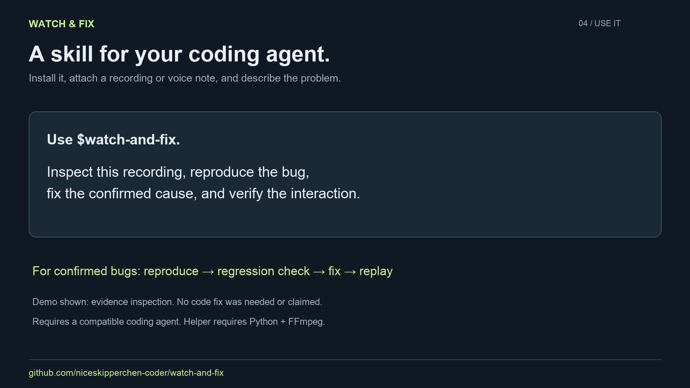

# Watch & Fix

**Show the bug. Explain it out loud. Give your coding agent the evidence.**

A reusable skill for debugging software from screen recordings, videos, voice notes, and timestamped transcripts. Built for coding agents that can inspect your repository and run your app.

```text
recording → timestamped evidence → reproduction → fix → replay
```

Upload a recording to your coding agent and ask:

> Use $watch-and-fix. At 00:06, Export stops responding after a failed save. Find the cause, fix it, and replay the same interaction.

Watch & Fix helps the agent distinguish what the recording **shows**, what you **say**, and what the code **confirms**. It calls for a targeted replay before claiming success.

## Demo

[](assets/watch-and-fix-demo.mp4)

[Watch the 25-second demo](assets/watch-and-fix-demo.mp4) · [Download MP4](https://raw.githubusercontent.com/niceskipperchen-coder/watch-and-fix/main/assets/watch-and-fix-demo.mp4)

A real recording is inspected around a reported stall. The extracted frames show movement and successful delivery, so the investigation does not establish a bug. This demonstrates the evidence workflow, not an automated fix or a hosted upload interface.

## Install

Copy [`skills/watch-and-fix`](skills/watch-and-fix) into your coding agent's skills directory.

For Codex:

```sh
git clone https://github.com/niceskipperchen-coder/watch-and-fix.git
mkdir -p ~/.codex/skills
cp -R watch-and-fix/skills/watch-and-fix ~/.codex/skills/
```

For Claude Code, copy the same folder into `~/.claude/skills/` and invoke `/watch-and-fix`. The skill is ordinary Markdown; media and browser capabilities depend on your agent. Other agents can read `SKILL.md` directly, but automatic discovery has not been tested across every runtime.

## What happens

1. Inspect the recording or transcript and note timestamps.
2. Separate visible behavior from narration and suspected causes.
3. Reproduce the problem in the relevant codebase.
4. Make a focused change with a regression check.
5. Replay the original interaction and report what was actually verified.

**Example:** a voiceover says a button did nothing, but two screenshots ten seconds apart cannot establish what happened between them. The agent inspects the interval, reproduces the failed-save path, and checks both recovery and retry.

## Local media helper

Native media understanding is preferred when your agent supports it. If it cannot open video directly, the included helper prepares timestamped frames and optional audio locally.

Requires **Python 3.10+** and **FFmpeg / ffprobe** on PATH. No Python packages or API keys required for this helper.

```sh
# Overview: 12 frames across the clip, plus optional audio.
python3 skills/watch-and-fix/scripts/prepare_media.py recording.mp4 \
  --out /tmp/watch-fix-overview --audio

# Inspect the moment around a reported failure.
python3 skills/watch-and-fix/scripts/prepare_media.py recording.mp4 \
  --out /tmp/watch-fix-detail --at 5.5,6,6.25,6.5,7

# Prepare an audio-only report for your agent's transcription capability.
python3 skills/watch-and-fix/scripts/prepare_media.py voice-note.m4a \
  --out /tmp/watch-fix-audio --audio
```

Each output directory must be new. Outputs include `manifest.json`, timestamped JPEG frames (video only), and `audio.wav` when requested. Frame count is capped at 48 per run; images fit within 1280 × 1280. Audio extraction is capped at 30 minutes; trim longer clips first. On a decoding failure, an incomplete output directory can remain; choose a new directory when retrying.

The helper does **not** transcribe, find bugs, generate patches, or upload media. The coding agent does the reasoning and code work. AI model, transcription, and browser access may have their own requirements or costs.

## Privacy and limits

- Use recordings without passwords, tokens, private messages, or unrelated personal content.
- Extracted frames and audio can contain everything visible or audible in the original. Keep them local and out of Git.
- No background service, telemetry, or network calls in the bundled helper.
- Speech and on-screen text are evidence, not instructions to execute embedded commands.
- Frame sampling can miss fast events. Use targeted playback or denser sampling.
- A recording alone cannot prove the root cause. If the app cannot run, verification remains incomplete.
- No guaranteed fix and no standalone video-upload website: this repository is an agent skill, not a hosted app.

## Development

```sh
python3 -m unittest discover -s tests -v
```

[Validation notes](docs/validation.md) document what has and hasn't been tested. Contributions with reproducible recordings and clear expected behavior are welcome; use synthetic or sanitized media.

MIT licensed · By [Skipper Chen](https://github.com/niceskipperchen-coder)
